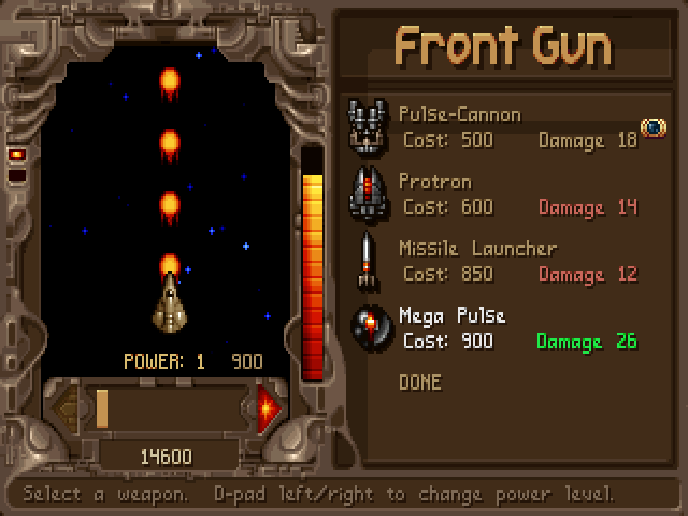
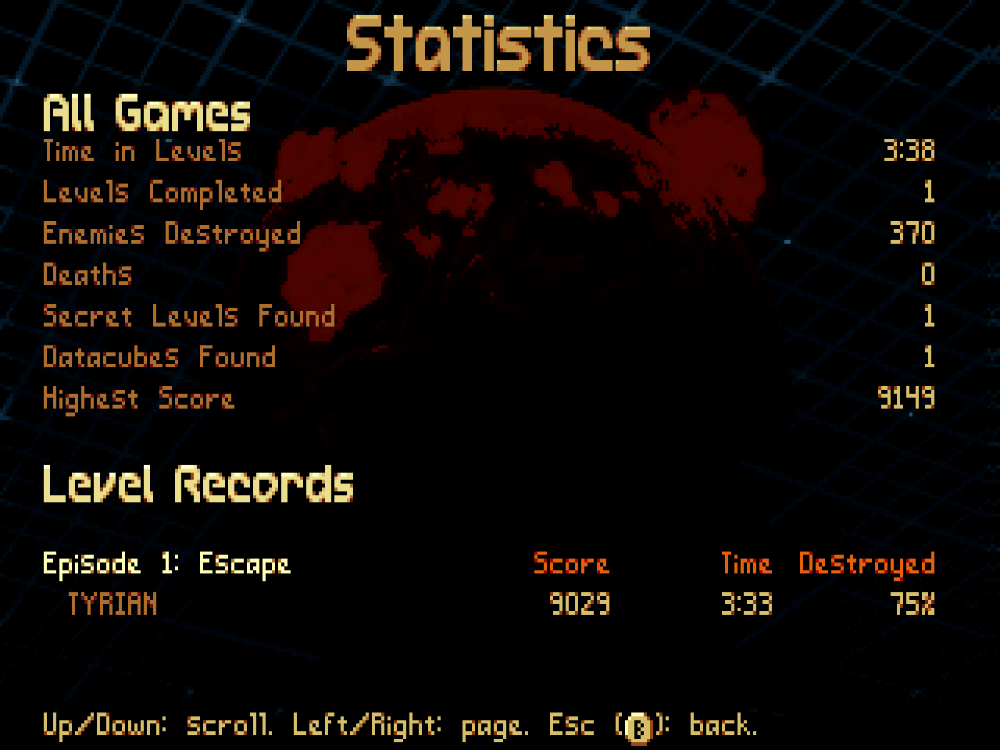

# Tyrian 2000+

**Português** | [English](README.md)

Tyrian 2000 com controles modernos, para Windows, Linux e Steam Deck.

**Projeto de fã, gratuito e não oficial.** Não é feito, vendido nem apoiado
pela Eclipse Software, por Jason Emery ou pelas editoras originais. Os dados
do jogo são os da versão freeware original, sem nenhuma alteração.

**[⬇ Baixar (GitHub Releases)](https://github.com/gabrielbadolato/tyrian2000plus/releases/latest)** ·
**[⬇ Baixar no itch.io](https://gabrielbadolato.itch.io/tyrian2000plus)**

Grátis, já com os dados originais do jogo: instalador ou .zip para Windows,
e Linux / Steam Deck. Como instalar está [mais abaixo](#instalação).
Ou jogue direto no navegador, na página do itch.io, sem instalar nada,
inclusive no celular ou tablet (controles na tela). Os saves ficam guardados
naquele navegador, e dá para levá-los ao computador e trazer de volta (veja
[Jogos salvos](#jogos-salvos-entre-computador-e-navegador)).

<table>
  <tr>
    <td></td>
    <td></td>
  </tr>
  <tr>
    <td></td>
    <td></td>
  </tr>
  <tr>
    <td></td>
    <td></td>
  </tr>
</table>

O que mudou em cada versão está no [CHANGELOG.md](CHANGELOG.md) (em inglês).

## O que é

Tyrian é um jogo de nave com rolagem vertical, lançado em 1995. A história se
passa no ano 20.031: você é Trent Hawkins, um piloto de caça que precisa salvar
a galáxia. O jogo foi criado pela Eclipse Software e publicado pela Epic
MegaGames. O Tyrian 2000 (1999) trouxe um quinto episódio. Depois, Jason Emery
liberou o jogo como freeware.

O Tyrian 2000+ é baseado no [OpenTyrian2000](https://github.com/KScl/opentyrian2000),
que por sua vez vem do [OpenTyrian](https://github.com/opentyrian/opentyrian), a
versão de código aberto do Tyrian. O que esta versão acrescenta:

- Suporte a controles modernos: Xbox, PlayStation, Switch Pro, Steam Controller
  e outros, com vibração e troca de controle sem reiniciar.
- Desenho do controle mostrando a função de cada botão (Controller Map).
- Tiro automático (Auto Fire) e opção de vibração (desligada, fraca ou forte).
- Nomes dos botões do controle nas telas de ajuda.
- Teclado na tela para digitar com o controle o nome do jogo salvo e dos
  recordes, e aviso quando a bateria do controle está fraca.
- "Continue" (Continuar) na tela de título: volta ao último jogo com um toque,
  e ao ponto exato da fase se o jogo fechou no meio dela.
- "Replay Last Level" (Rever a última fase) no Setup: assista de novo à
  última fase que você jogou.
- No menu de melhorias da nave, cada item mostra o dano (ou casco, escudo ou
  energia) em verde quando é melhor do que o da sua nave e em vermelho quando
  é pior.
- Um segundo som de música para escolher em Setup > Sound: o emulador Nuked
  OPL3, próximo de uma placa Sound Blaster de 1995 de verdade (o som clássico
  continua sendo o padrão).
- Mais opções de vídeo, inclusive na pausa, e o filtro Sharp Bilinear.
- Movimento suave (Setup > Graphics > Smooth Motion, ligado por padrão): o
  jogo continua rodando a 35 quadros por segundo, igual ao original, mas a
  tela mostra o movimento entre um quadro e outro na taxa do seu monitor (60,
  120, 144, 240 Hz...), nas fases, nos escurecimentos entre telas e na prévia
  das armas do menu da nave.
  Nas fases, as imagens do meio são desenhadas em até 4x a resolução do jogo
  (conforme o tamanho da janela, com o scaler "None"), então até um fundo que
  anda um pixel por quadro desliza de quarto em quarto de pixel.
- Menus, ajuda e nomes dos itens em português.
- Versões prontas para Windows, Linux e Steam Deck.
- Tela About com a história do projeto e os créditos.
- Tela de novidades (What's New) com o que mudou em cada versão, em português
  ou inglês, que mostra também o que uma versão mais nova traz antes de você
  atualizar.

## Um recado do Gabriel

Oi! Eu sou o Gabriel Badolato, do Brasil.

O Tyrian 2000 fez parte da minha infância. Foi um dos jogos que me fizeram
gostar de computadores, e anos depois eu trabalhei com eles. Eu queria jogá-lo
de novo com um controle moderno, numa tela grande e no Steam Deck. Por isso
comecei este projeto.

Não sou desenvolvedor de jogos. Trabalhei com TI por anos, e agora estou
terminando a graduação em biomedicina, com a ideia de trabalhar com
bioinformática. Aprendi a programar na faculdade, mas nunca escrevi muito
código. O Claude, um assistente de IA da Anthropic, escreveu a maior parte
dele. Eu testei cada versão no meu PC e nos meus controles.

Obrigado ao Jason Emery, ao Alexander Brandon, ao Daniel Cook e a todos da
Eclipse Software, e aos desenvolvedores do OpenTyrian e do OpenTyrian2000, que
mantiveram o jogo vivo.

Este projeto é gratuito, e sempre será.

Obrigado por jogar!

## Instalação

Os pacotes das versões publicadas (página Releases do GitHub e itch.io) já
trazem os dados originais do jogo: é só descompactar e jogar (pule o passo 2).
Se a pasta `data` estiver vazia, baixe os dados à parte (são gratuitos):
<https://www.camanis.net/tyrian/tyrian2000.zip>

### Windows

O jeito mais fácil é o instalador: baixe o
`Tyrian2000Plus-vX.Y.Z-windows-x64-setup.exe` e abra. Ele não pede senha de
administrador, põe o Tyrian 2000+ no menu Iniciar (e, se a caixa ficar
marcada, na área de trabalho) e pode ser removido em Configurações >
Aplicativos. Os saves e as configurações ficam em `%APPDATA%\Tyrian2000Plus`
ao atualizar ou desinstalar. Para atualizar, abra o instalador da versão nova.

O Windows pode mostrar "O Windows protegeu o computador", porque o
instalador não é assinado: clique em "Mais informações" > "Executar assim
mesmo".

Ou, sem instalar:

1. Baixe o `Tyrian2000Plus-vX.Y.Z-windows-x64.zip` (vX.Y.Z é a versão, por
   exemplo v1.0.5) e descompacte numa pasta sua.
2. Descompacte o `tyrian2000.zip` e copie **todos** os arquivos de dentro da
   pasta `tyrian2000` (tyrian.hdt, tyrian1.lvl, music.mus etc.) para a pasta
   `data`, ao lado do `Tyrian2000Plus.exe`.
3. Conecte o controle e abra o `Tyrian2000Plus.exe`.

### Steam Deck e Linux

O jeito mais fácil é o script de instalação, que depois também atualiza o
jogo:

1. No Modo Desktop, baixe o `Tyrian2000Plus-vX.Y.Z-instalar-steam-deck.sh`
   da página Releases.
2. Abra o Konsole e rode `bash ~/Downloads/Tyrian2000Plus-*-instalar-steam-deck.sh`.
3. Ele instala o jogo em `~/Jogos/Tyrian2000Plus` (com os dados do jogo),
   cria atalhos no menu e põe o "Tyrian 2000+" na biblioteca da Steam. Para
   isso, a Steam precisa fechar por alguns segundos; o script pergunta antes
   e abre a Steam de novo.
4. Volte ao Modo de Jogo e abra o Tyrian 2000+ pela biblioteca.

Para atualizar, use "Atualizar Tyrian 2000+" no menu do Modo Desktop (ou
rode `~/Jogos/Tyrian2000Plus/atualizar-tyrian.sh`).

Ou à mão:

1. No Modo Desktop, descompacte o `Tyrian2000Plus-vX.Y.Z-linux-x86_64.tar.gz`
   (botão direito > Extrair aqui) numa pasta sua, por exemplo `/home/deck/Jogos`.
2. Se a pasta `data` estiver vazia, copie os dados do jogo para ela, como no
   passo 2 do Windows.
3. Na Steam: "Adicionar um jogo" > "Adicionar um jogo não-Steam" > "Procurar",
   escolha o arquivo `Tyrian2000Plus` e confirme.
4. Volte ao Modo de Jogo e abra o Tyrian2000Plus pela biblioteca.

O arquivo `Tyrian2000Plus.png` pode ser usado como ícone na Steam. Quem
instalou pelo app do itch.io não precisa do script: o app atualiza sozinho.

**Tela do Deck:** o padrão é "Fit 4:3", fiel aos monitores de 1995. Para tela
cheia com pixels nítidos, use Setup > Graphics > Scaling Mode > "Integer". O
jogo roda a 35 quadros por segundo; o movimento suave (Smooth Motion, ligado
por padrão) mostra o movimento na taxa da tela, então qualquer taxa
serve. Se desligá-lo, ponha o Deck OLED em 70 Hz (perfil por jogo) e deixe o
Deck LCD em 60 Hz. Não ligue o limite de quadros da Steam.

## Controles

| Controle (Xbox)       | Função                              |
|-----------------------|-------------------------------------|
| Analógico ou D-pad    | Mover a nave                        |
| A ou RT               | Atirar                              |
| Y                     | Trocar o modo da arma traseira      |
| LB ou LT              | Sidekick esquerdo                   |
| RB ou X               | Sidekick direito                    |
| B                     | Os dois sidekicks juntos            |
| Start (Menu)          | Menu do jogo                        |
| Back (View)           | Pausa                               |

Nos menus, A confirma e B volta. Nos controles PlayStation e Switch Pro, os
botões nas mesmas posições fazem a mesma coisa. Os botões podem ser trocados
em Setup > Controls > Controller... > Buttons.

Teclado: setas movem, Espaço atira, Enter troca a arma traseira, Ctrl e Alt
usam os sidekicks. Teclas que valem em todo o jogo (também listadas em
Setup > Controls > Shortcuts):

| Tecla     | O que faz                                        |
|-----------|--------------------------------------------------|
| Alt+Enter | Alterna entre tela cheia e janela                |
| Esc       | Abre o menu durante a fase; nos menus, volta     |
| P         | Pausa o jogo durante a fase                      |
| F1        | Ajuda, na fase ou no menu da nave                |
| F11       | Brilho, durante a fase                           |

Em janela, o jogo abre onde estava da última vez, com o mesmo tamanho (na
primeira vez, do maior tamanho que cabe bem na tela).

**Tela de toque** (celular ou tablet, no navegador): toque na tela e aparecem
um direcional e botões ao lado do jogo (embaixo dele com o celular em pé): o
direcional move, TIRO atira, SIDEKICKS dispara os dois sidekicks, MODO troca
a arma traseira e MENU abre o menu do jogo. Também dá para arrastar o dedo
sobre o próprio jogo: a nave vai junto, atirando. Nos menus, toque no item,
ou use o direcional e TIRO (OK) / MENU (voltar). Teclado ou controle fazem
os controles de toque sumirem de novo.

## Onde fica cada opção

- **Tela de título > Setup:** vídeo (Graphics), som
  (Sound), controles (Controls), velocidade do jogo (Game Speed), idioma
  (Language), aviso de versão (Check Updates), jogos salvos (Saved Games),
  Jukebox, rever a
  última fase (Replay Last Level), estatísticas (Statistics), novidades
  (What's New) e About.
- **Tela de título > Continue (Continuar):** carrega o último jogo salvo ou
  carregado (o jogo também salva "LAST LEVEL" ao chegar na nave depois de
  cada fase e ao começar cada fase). Só aparece quando existe um. Se o jogo
  fechou no meio de uma fase (janela fechada, Steam Deck desligado, travou),
  o Continue volta àquele ponto da fase e pausa ali; leva alguns segundos,
  porque o jogo repete a fase escondido até aquele ponto. Sair da fase pelo
  menu dela continua sendo desistir da fase, como sempre.
- **Setup > Replay Last Level (Rever a última fase):** mostra de novo a
  última fase que você jogou (ela é gravada enquanto você joga, no
  lastlevel.rec da sua pasta de usuário). Qualquer tecla ou botão para. Só
  aparece quando há uma fase gravada, no Setup da tela de título.
- **Setup > Sound > Music Sound (Som da música):** "Classic" (Clássico, o
  padrão, o emulador que o OpenTyrian sempre usou) ou "Accurate" (Fiel, Nuked
  OPL3).
- **Setup > Controls:** teclado, controle, mouse, Auto Fire, vibração
  (Vibration), o desenho do controle (Controller Map, com o nível da bateria)
  e a lista de atalhos do teclado (Shortcuts).
- **Para digitar um nome com o controle** (ao salvar o jogo ou num recorde):
  aparece um teclado embaixo do nome. O direcional anda, A digita, B apaga,
  Start termina e Back cancela.
- **Menu da nave (entre as fases) > Upgrade Ship (Melhorar nave):** ao lado
  do preço de cada item há um número para comparar com o que a sua nave tem,
  em verde quando é melhor e em vermelho quando é pior: dano por segundo das
  armas e sidekicks (na potência mostrada; conta só os acertos diretos, então
  tiros teleguiados ou que atravessam podem render mais), casco das naves,
  força dos escudos e energia dos geradores.
- **Menu da nave (entre as fases) > Options > Setup...:** o mesmo Setup. Os
  itens Joystick, Keyboard e Mouse de lá abrem as mesmas telas de
  Setup > Controls.
- **Durante a fase, Start ou Esc:** volume, velocidade, Auto Fire,
  Controls... (o mesmo Setup > Controls) e Graphics... (tela cheia, escala,
  Sharp Bilinear, VSync, movimento suave e brilho, aplicados na hora).
- **Setup > Statistics (Estatísticas):** os totais de todos os seus jogos
  (tempo nas fases, fases concluídas, inimigos destruídos, mortes, fases
  secretas, datacubes, maior pontuação) e os recordes de cada fase: maior
  pontuação, menor tempo e mais inimigos destruídos. Ficam no arquivo
  statistics.cfg, junto dos saves.
- **Setup > Saved Games (Jogos salvos):** no Windows e no Linux, abre a
  pasta do tyrian.sav (seus jogos salvos) e mostra o caminho dela na linha
  de baixo (no Steam Deck em Modo de Jogo não há gerenciador de arquivos, e
  fica só o caminho); no navegador, baixa ou carrega esse arquivo. Veja
  abaixo.
- **Setup > About (Sobre):** o que é o jogo, de onde veio, os créditos e os
  links (Enter ou A abre o link no navegador).
- **Setup > What's New (Novidades)** (também no alto do About): o que mudou
  em cada versão, da mais nova para a mais antiga, em português ou inglês. Se
  já saiu uma versão mais nova, as notas dela aparecem primeiro, para você ver
  o que ela traz antes de atualizar. Depois de uma atualização, a tela de
  título mostra "Novidades em Configurações." até você abrir a tela.
- **Setup > Language:** menus, ajuda e nomes dos itens em português ou em
  inglês. "Automatic" (o padrão) segue o idioma do sistema; em português, o
  Setup aparece como "Configurações" e a opção como "Idioma". As histórias dos
  datacubes continuam em inglês.
- **Setup > Check Updates (Aviso de versão):** ao abrir, o jogo pergunta ao GitHub qual é a
  última versão publicada. Se houver uma mais nova, aparece um aviso no canto
  da tela de título, e o About mostra os links para baixar (itch.io e GitHub). A mesma
  resposta traz as notas de cada versão para a tela de novidades, guardadas
  no release-notes.txt da sua pasta de usuário para quando não houver
  internet. Nenhum dado seu é enviado; sem internet, nada aparece. Coloque em
  "Off" para desligar. No navegador o jogo nunca pergunta (aquela versão é
  sempre a mais nova do itch.io); a própria página busca as notas para a
  tela de novidades.

## Jogos salvos entre computador e navegador

Todos os seus jogos salvos e recordes ficam num arquivo só, o `tyrian.sav`,
igual em todas as versões (é até o formato do jogo original).

- **Do navegador para o computador:** no navegador, Configurações > Jogos
  salvos... (ou "Jogos salvos" na primeira tela, antes do Jogar) > "Baixar o
  tyrian.sav". No computador, com o jogo na tela de título (ou fechado),
  Configurações > Jogos salvos... abre a pasta do jogo: ponha ali o
  `tyrian.sav` baixado, substituindo o que estiver lá.
- **Do computador para o navegador:** no computador, Configurações > Jogos
  salvos... abre a pasta do `tyrian.sav`. No navegador, Configurações > Jogos
  salvos... > "Carregar um tyrian.sav..." e escolha esse arquivo. O navegador
  guarda os saves anteriores como `tyrian-antes-de-carregar.sav` e reabre o
  jogo.

A pasta do jogo é `%APPDATA%\Tyrian2000Plus` no Windows e
`~/.config/tyrian2000plus` no Linux e no Steam Deck. Um `tyrian.sav` posto
ali com o jogo aberto é lido quando você volta à tela de título, e o jogo não
grava por cima dele ao fechar.

## Dicas do Steam Controller

- No Windows, o jogo lê o Steam Controller direto, sem precisar da Steam:
  botões, nomes dos botões e vibração funcionam.
- **Com a Steam aberta**, deixe o controle no **modo gamepad** da Steam:
  segure o botão Start até aparecer o aviso da Steam. Assim tudo funciona
  normalmente. No modo teclado e mouse da Steam, os botões contam duas vezes
  e o X abre o teclado virtual dela; o jogo não tem como impedir isso.
- Também funciona fechar a Steam antes de jogar, ou adicionar o jogo na Steam
  como jogo não-Steam e abri-lo pela biblioteca.
- No Linux e no Steam Deck, o Steam Controller 2026 só funciona com o jogo
  aberto pela Steam.

## Problemas

O jogo grava o arquivo `opentyrian.log` na pasta do usuário, junto com os
saves e a configuração: `%APPDATA%\Tyrian2000Plus` no Windows (digite esse
caminho na barra de endereço do Explorador de Arquivos) e
`~/.config/tyrian2000plus` no Linux e no Steam Deck. Envie esse arquivo ao
relatar um problema.

Se a pasta do jogo tiver um arquivo `opentyrian.cfg`, tudo isso fica na
própria pasta do jogo (modo portátil). Até a v1.0.4, a pasta do usuário era
a do OpenTyrian2000 original (`%APPDATA%\OpenTyrian2000`,
`~/.config/opentyrian2000`): na primeira vez que abre, o jogo copia os saves
e a configuração de lá e deixa aquela pasta como estava.

## Licença

- O programa é software livre, sob a GNU General Public License, versão 2 ou
  posterior (arquivo `COPYING`). O código-fonte está neste repositório.
- Os dados do Tyrian 2000 são freeware. A licença de Jason Emery diz: *"Feel
  free to play it all you want and share it with friends."* (jogue o quanto
  quiser e compartilhe com os amigos). Veja `doc/tyrian-freeware-license.txt`.
- Este projeto é e sempre será gratuito.

## Créditos

**Tyrian e Tyrian 2000** (créditos do próprio jogo): Eclipse Software.
Jason Emery (programação, design das fases e tudo mais), Alexander Brandon
(história e música), Andreas Molnar (sistema de som LOUDNESS), Daniel Cook
(arte do jogo e da interface), Cayenne Mandua (arte do Tyrian 2000), Devon
Tackett, John Calcagno, Andrew Paquette, Arturo Sinclair, Bruce Hsu, Markus
Mueller, Susan Aldworth, Nando Eweg, o produtor Robert Allen e os testadores
Aaron Hartman, Lee Cheramie e Andy Lehrfeld. A lista completa aparece na
tela About do jogo.

**OpenTyrian:** The OpenTyrian Development Team e colaboradores: Carl Reinke,
Yuri Kunde Schlesner, mvcixT, syntaxglitch, Alex Rodionov, Stephan T. Lavavej,
emacs.hacker, Miro Kropacek, Alexandre Detiste, sweetlilmre, Sander van Dijk,
a.h.vandijk, qon, Adam Vandenberg, Dmitry Marakasov, Jan Alexander Steffens,
Jeff Smith, Kane, Pedro Catalão, Renato Alves, Sergii Pylypenko, George
Rawlinson, mcpusc, norm2782, okkirikomi, Patryk Obara e AshTR.

**OpenTyrian2000:** Kaito Sinclaire (KScl).

**Tyrian 2000+:** Gabriel Badolato, com ajuda do Claude (Anthropic).

**Agradecimentos:** Sam Lantinga e a equipe do [SDL](https://www.libsdl.org/),
o [camanis.net](https://www.camanis.net/tyrian/) por manter os dados freeware
disponíveis, e os fãs do Tyrian que mantêm o jogo vivo.

## Links

- Tyrian 2000+: <https://github.com/gabrielbadolato/tyrian2000plus>
- Tyrian 2000+ no itch.io: <https://gabrielbadolato.itch.io/tyrian2000plus>
- OpenTyrian2000: <https://github.com/KScl/opentyrian2000>
- OpenTyrian: <https://github.com/opentyrian/opentyrian>
- Dados freeware do Tyrian 2000: <https://www.camanis.net/tyrian/>

## Para quem quer compilar

- Windows x64 (a partir do Linux): `./make_windows.sh`; instalador (precisa do
  NSIS): `./make_installer.sh dist/Tyrian2000Plus-windows-x64 setup.exe`
- Linux x86_64 / Steam Deck: `./make_linux.sh`
- Testes: `tests/run_tests.sh [pasta-do-jogo]`

O texto original do OpenTyrian2000 (em inglês) está em
`doc/README-OpenTyrian2000`.
