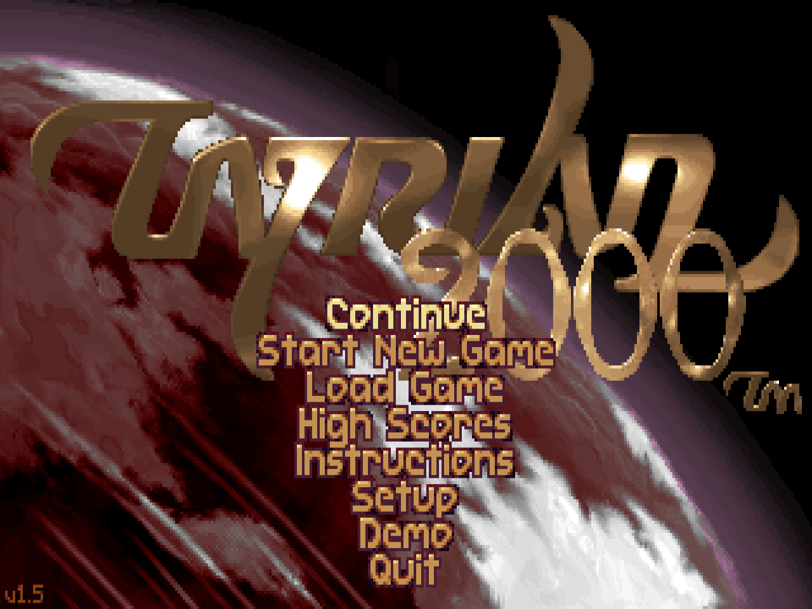
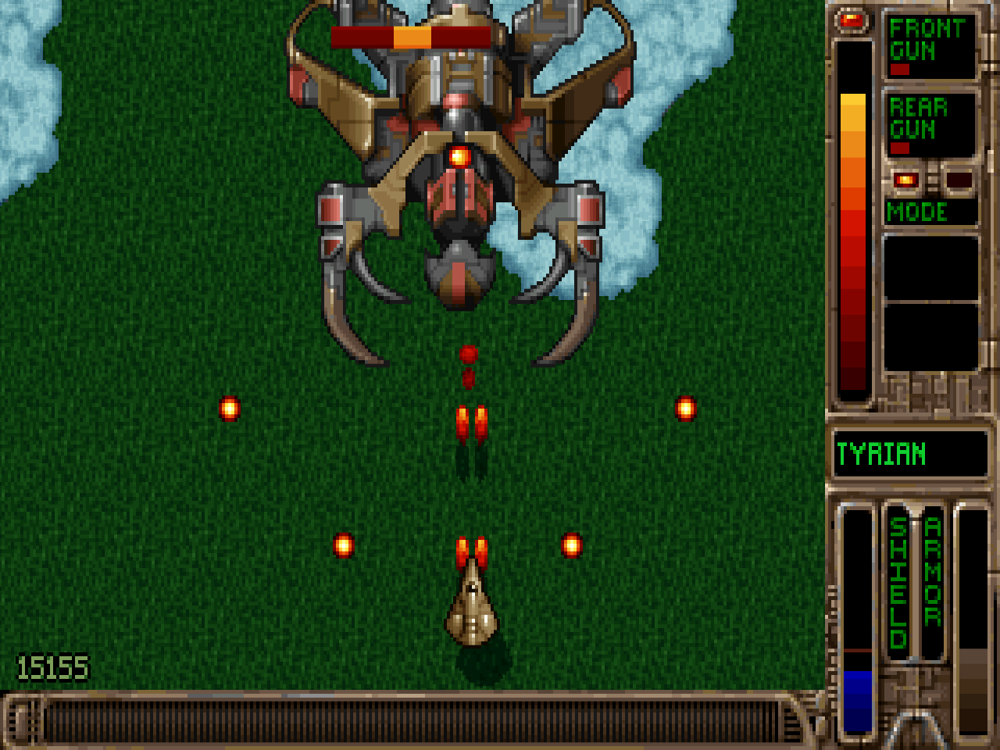
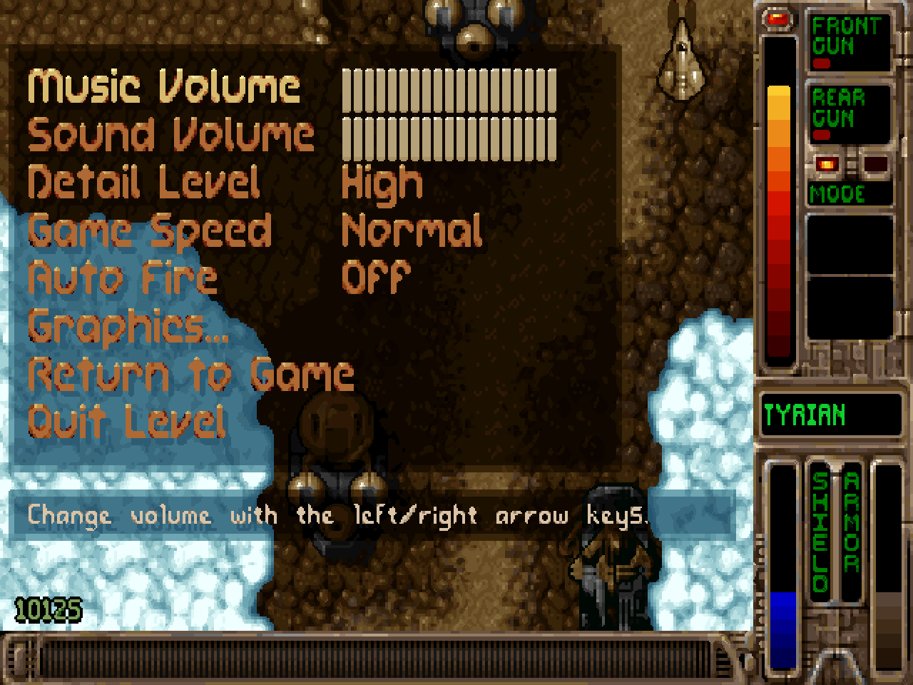
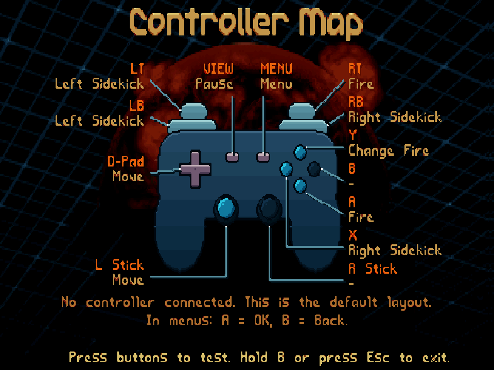

# Tyrian 2000+

**Português** | [English](README.md)

Tyrian 2000 com controles modernos, para Windows, Linux e Steam Deck.

**Projeto de fã, gratuito e não oficial.** Não é feito, vendido nem apoiado
pela Eclipse Software, por Jason Emery ou pelas editoras originais. Os dados
do jogo são os da versão freeware original, sem nenhuma alteração.

**[⬇ Baixar (GitHub Releases)](https://github.com/gabrielbadolato/tyrian2000plus/releases/latest)** ·
**[⬇ Baixar no itch.io](https://gabrielbadolato.itch.io/tyrian2000plus)**

Grátis, já com os dados originais do jogo: instalador ou .zip para Windows,
e Linux / Steam Deck. Como instalar está [mais abaixo](#instalação).

<table>
  <tr>
    <td></td>
    <td></td>
  </tr>
  <tr>
    <td></td>
    <td></td>
  </tr>
</table>

O que mudou em cada versão está no [CHANGELOG.md](CHANGELOG.md) (em inglês).

## O que é

Tyrian é um jogo de nave com rolagem vertical, lançado em 1995. A história se
passa no ano 20.031: você é Trent Hawkins, um piloto de caça que precisa salvar
a galáxia. O jogo foi criado pela Eclipse Software e publicado pela Epic
MegaGames. O Tyrian 2000 (1999) trouxe um quinto episódio. Depois, Jason Emery
liberou o jogo como freeware.

O Tyrian 2000+ é baseado no [OpenTyrian2000](https://github.com/KScl/opentyrian2000),
que por sua vez vem do [OpenTyrian](https://github.com/opentyrian/opentyrian), a
versão de código aberto do Tyrian. O que esta versão acrescenta:

- Suporte a controles modernos: Xbox, PlayStation, Switch Pro, Steam Controller
  e outros, com vibração e troca de controle sem reiniciar.
- Desenho do controle mostrando a função de cada botão (Controller Map).
- Tiro automático (Auto Fire).
- Nomes dos botões do controle nas telas de ajuda.
- Mais opções de vídeo, inclusive na pausa, e o filtro Sharp Bilinear.
- Menus, ajuda e nomes dos itens em português.
- Versões prontas para Windows, Linux e Steam Deck.
- Tela About com a história do projeto e os créditos.

## Um recado do Gabriel

Oi! Eu sou o Gabriel Badolato, do Brasil.

O Tyrian 2000 fez parte da minha infância. Foi um dos jogos que me fizeram
gostar de computadores, e anos depois eu trabalhei com eles. Eu queria jogá-lo
de novo com um controle moderno, numa tela grande e no Steam Deck. Por isso
comecei este projeto.

Não sou desenvolvedor de jogos. Trabalhei com TI por anos, e agora estou
terminando a graduação em biomedicina, com a ideia de trabalhar com
bioinformática. Aprendi a programar na faculdade, mas nunca escrevi muito
código. O Claude, um assistente de IA da Anthropic, escreveu a maior parte
dele. Eu testei cada versão no meu PC e nos meus controles.

Obrigado ao Jason Emery, ao Alexander Brandon, ao Daniel Cook e a todos da
Eclipse Software, e aos desenvolvedores do OpenTyrian e do OpenTyrian2000, que
mantiveram o jogo vivo.

Este projeto é gratuito, e sempre será.

Obrigado por jogar!

## Instalação

Os pacotes das versões publicadas (página Releases do GitHub e itch.io) já
trazem os dados originais do jogo: é só descompactar e jogar (pule o passo 2).
Se a pasta `data` estiver vazia, baixe os dados à parte (são gratuitos):
<https://www.camanis.net/tyrian/tyrian2000.zip>

### Windows

O jeito mais fácil é o instalador: baixe o
`Tyrian2000Plus-vX.Y.Z-windows-x64-setup.exe` e abra. Ele não pede senha de
administrador, põe o Tyrian 2000+ no menu Iniciar (e, se a caixa ficar
marcada, na área de trabalho) e pode ser removido em Configurações >
Aplicativos. Os saves e as configurações ficam em `%APPDATA%\Tyrian2000Plus`
ao atualizar ou desinstalar. Para atualizar, abra o instalador da versão nova.

O Windows pode mostrar "O Windows protegeu o computador", porque o
instalador não é assinado: clique em "Mais informações" > "Executar assim
mesmo".

Ou, sem instalar:

1. Baixe o `Tyrian2000Plus-vX.Y.Z-windows-x64.zip` (vX.Y.Z é a versão, por
   exemplo v1.0.5) e descompacte numa pasta sua.
2. Descompacte o `tyrian2000.zip` e copie **todos** os arquivos de dentro da
   pasta `tyrian2000` (tyrian.hdt, tyrian1.lvl, music.mus etc.) para a pasta
   `data`, ao lado do `Tyrian2000Plus.exe`.
3. Conecte o controle e abra o `Tyrian2000Plus.exe`.

### Steam Deck e Linux

O jeito mais fácil é o script de instalação, que depois também atualiza o
jogo:

1. No Modo Desktop, baixe o `Tyrian2000Plus-vX.Y.Z-instalar-steam-deck.sh`
   da página Releases.
2. Abra o Konsole e rode `bash ~/Downloads/Tyrian2000Plus-*-instalar-steam-deck.sh`.
3. Ele instala o jogo em `~/Jogos/Tyrian2000Plus` (com os dados do jogo),
   cria atalhos no menu e põe o "Tyrian 2000+" na biblioteca da Steam. Para
   isso, a Steam precisa fechar por alguns segundos; o script pergunta antes
   e abre a Steam de novo.
4. Volte ao Modo de Jogo e abra o Tyrian 2000+ pela biblioteca.

Para atualizar, use "Atualizar Tyrian 2000+" no menu do Modo Desktop (ou
rode `~/Jogos/Tyrian2000Plus/atualizar-tyrian.sh`).

Ou à mão:

1. No Modo Desktop, descompacte o `Tyrian2000Plus-vX.Y.Z-linux-x86_64.tar.gz`
   (botão direito > Extrair aqui) numa pasta sua, por exemplo `/home/deck/Jogos`.
2. Se a pasta `data` estiver vazia, copie os dados do jogo para ela, como no
   passo 2 do Windows.
3. Na Steam: "Adicionar um jogo" > "Adicionar um jogo não-Steam" > "Procurar",
   escolha o arquivo `Tyrian2000Plus` e confirme.
4. Volte ao Modo de Jogo e abra o Tyrian2000Plus pela biblioteca.

O arquivo `Tyrian2000Plus.png` pode ser usado como ícone na Steam. Quem
instalou pelo app do itch.io não precisa do script: o app atualiza sozinho.

**Tela do Deck:** o padrão é "Fit 4:3", fiel aos monitores de 1995. Para tela
cheia com pixels nítidos, use Setup > Graphics > Scaling Mode > "Integer". O
jogo roda a 35 quadros por segundo: no Deck OLED, ponha a taxa de atualização
em 70 Hz (perfil por jogo); no Deck LCD, deixe em 60 Hz. Não ligue o limite de
quadros da Steam.

## Controles

| Controle (Xbox)       | Função                              |
|-----------------------|-------------------------------------|
| Analógico ou D-pad    | Mover a nave                        |
| A ou RT               | Atirar                              |
| Y                     | Trocar o modo da arma traseira      |
| LB ou LT              | Sidekick esquerdo                   |
| RB ou X               | Sidekick direito                    |
| B                     | Os dois sidekicks juntos            |
| Start (Menu)          | Menu do jogo                        |
| Back (View)           | Pausa                               |

Nos menus, A confirma e B volta. Nos controles PlayStation e Switch Pro, os
botões nas mesmas posições fazem a mesma coisa. Os botões podem ser trocados
em Setup > Controls > Controller... > Buttons.

Teclado: setas movem, Espaço atira, Enter troca a arma traseira, Ctrl e Alt
usam os sidekicks, Esc abre o menu, P pausa, Alt+Enter alterna a tela cheia,
F1 mostra a ajuda e F11 muda o brilho.

## Onde fica cada opção

- **Tela de título > About:** o que é o jogo, de onde veio, os créditos e os
  links (Enter ou A abre o link no navegador).
- **Tela de título > Setup:** vídeo (Graphics), som (Sound), controles
  (Controls), Jukebox, idioma (Language), Check Updates e About.
- **Setup > Controls:** teclado, controle, mouse, Auto Fire e o desenho do
  controle (Controller Map).
- **Menu da nave (entre as fases) > Options > Setup...:** o mesmo Setup.
- **Durante a fase, Start ou Esc:** volume, detalhes, velocidade, Auto Fire,
  Controls... (o mesmo Setup > Controls) e Graphics... (tela cheia, escala,
  Sharp Bilinear, VSync e brilho, aplicados na hora).
- **Setup > About:** a mesma tela About, para ver no meio de um jogo salvo.
- **Setup > Language:** menus, ajuda e nomes dos itens em português ou em
  inglês. "Automatic" (o padrão) segue o idioma do sistema; em português, o
  Setup aparece como "Configurações" e a opção como "Idioma". As histórias dos
  datacubes continuam em inglês.
- **Setup > Check Updates:** ao abrir, o jogo pergunta ao GitHub qual é a
  última versão publicada. Se houver uma mais nova, aparece um aviso no canto
  da tela de título, e o About mostra os links para baixar (itch.io e GitHub). Nenhum dado seu é
  enviado; sem internet, nada aparece. Coloque em "Off" para desligar.

## Dicas do Steam Controller

- No Windows, o jogo lê o Steam Controller direto, sem precisar da Steam:
  botões, nomes dos botões e vibração funcionam.
- **Com a Steam aberta**, deixe o controle no **modo gamepad** da Steam:
  segure o botão Start até aparecer o aviso da Steam. Assim tudo funciona
  normalmente. No modo teclado e mouse da Steam, os botões contam duas vezes
  e o X abre o teclado virtual dela; o jogo não tem como impedir isso.
- Também funciona fechar a Steam antes de jogar, ou adicionar o jogo na Steam
  como jogo não-Steam e abri-lo pela biblioteca.
- No Linux e no Steam Deck, o Steam Controller 2026 só funciona com o jogo
  aberto pela Steam.

## Problemas

O jogo grava o arquivo `opentyrian.log` na pasta do usuário, junto com os
saves e a configuração: `%APPDATA%\Tyrian2000Plus` no Windows (digite esse
caminho na barra de endereço do Explorador de Arquivos) e
`~/.config/tyrian2000plus` no Linux e no Steam Deck. Envie esse arquivo ao
relatar um problema.

Se a pasta do jogo tiver um arquivo `opentyrian.cfg`, tudo isso fica na
própria pasta do jogo (modo portátil). Até a v1.0.4, a pasta do usuário era
a do OpenTyrian2000 original (`%APPDATA%\OpenTyrian2000`,
`~/.config/opentyrian2000`): na primeira vez que abre, o jogo copia os saves
e a configuração de lá e deixa aquela pasta como estava.

## Licença

- O programa é software livre, sob a GNU General Public License, versão 2 ou
  posterior (arquivo `COPYING`). O código-fonte está neste repositório.
- Os dados do Tyrian 2000 são freeware. A licença de Jason Emery diz: *"Feel
  free to play it all you want and share it with friends."* (jogue o quanto
  quiser e compartilhe com os amigos). Veja `doc/tyrian-freeware-license.txt`.
- Este projeto é e sempre será gratuito.

## Créditos

**Tyrian e Tyrian 2000** (créditos do próprio jogo): Eclipse Software.
Jason Emery (programação, design das fases e tudo mais), Alexander Brandon
(história e música), Andreas Molnar (sistema de som LOUDNESS), Daniel Cook
(arte do jogo e da interface), Cayenne Mandua (arte do Tyrian 2000), Devon
Tackett, John Calcagno, Andrew Paquette, Arturo Sinclair, Bruce Hsu, Markus
Mueller, Susan Aldworth, Nando Eweg, o produtor Robert Allen e os testadores
Aaron Hartman, Lee Cheramie e Andy Lehrfeld. A lista completa aparece na
tela About do jogo.

**OpenTyrian:** The OpenTyrian Development Team e colaboradores: Carl Reinke,
Yuri Kunde Schlesner, mvcixT, syntaxglitch, Alex Rodionov, Stephan T. Lavavej,
emacs.hacker, Miro Kropacek, Alexandre Detiste, sweetlilmre, Sander van Dijk,
a.h.vandijk, qon, Adam Vandenberg, Dmitry Marakasov, Jan Alexander Steffens,
Jeff Smith, Kane, Pedro Catalão, Renato Alves, Sergii Pylypenko, George
Rawlinson, mcpusc, norm2782, okkirikomi, Patryk Obara e AshTR.

**OpenTyrian2000:** Kaito Sinclaire (KScl).

**Tyrian 2000+:** Gabriel Badolato, com ajuda do Claude (Anthropic).

**Agradecimentos:** Sam Lantinga e a equipe do [SDL](https://www.libsdl.org/),
o [camanis.net](https://www.camanis.net/tyrian/) por manter os dados freeware
disponíveis, e os fãs do Tyrian que mantêm o jogo vivo.

## Links

- Tyrian 2000+: <https://github.com/gabrielbadolato/tyrian2000plus>
- Tyrian 2000+ no itch.io: <https://gabrielbadolato.itch.io/tyrian2000plus>
- OpenTyrian2000: <https://github.com/KScl/opentyrian2000>
- OpenTyrian: <https://github.com/opentyrian/opentyrian>
- Dados freeware do Tyrian 2000: <https://www.camanis.net/tyrian/>

## Para quem quer compilar

- Windows x64 (a partir do Linux): `./make_windows.sh`; instalador (precisa do
  NSIS): `./make_installer.sh dist/Tyrian2000Plus-windows-x64 setup.exe`
- Linux x86_64 / Steam Deck: `./make_linux.sh`
- Testes: `tests/run_tests.sh [pasta-do-jogo]`

O texto original do OpenTyrian2000 (em inglês) está em
`doc/README-OpenTyrian2000`.
